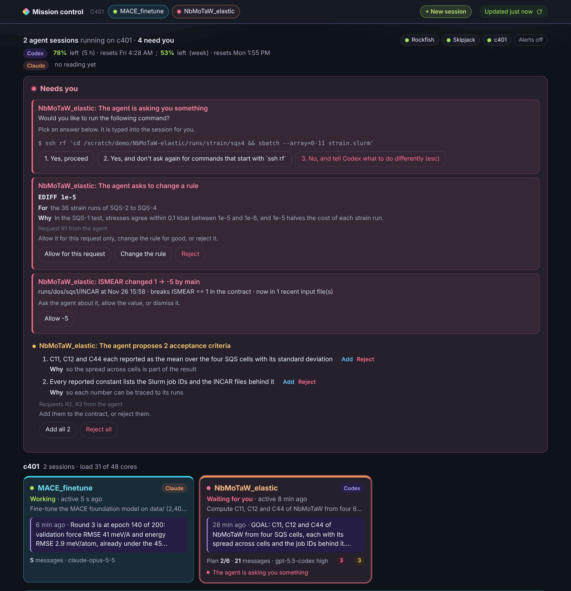
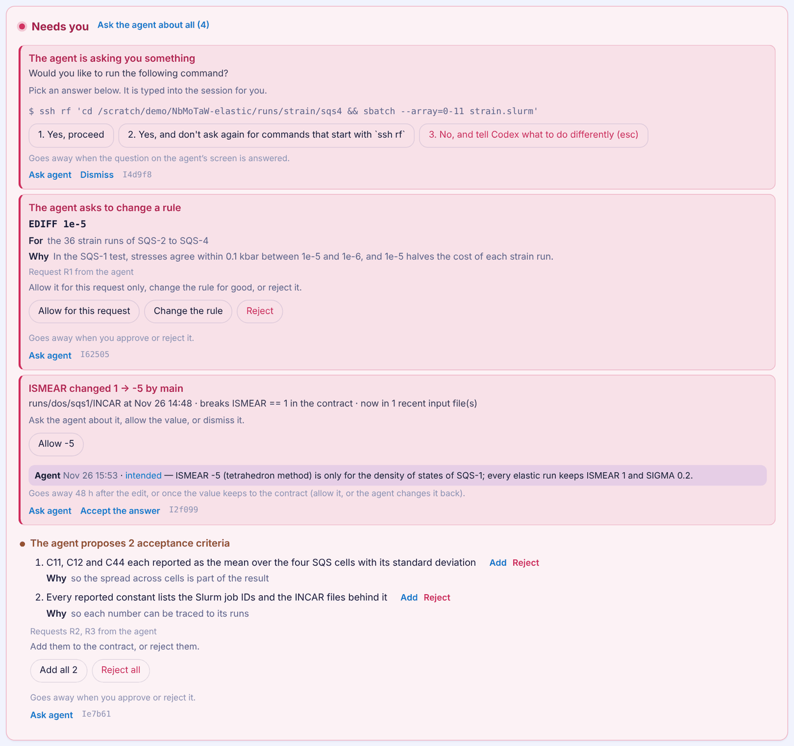
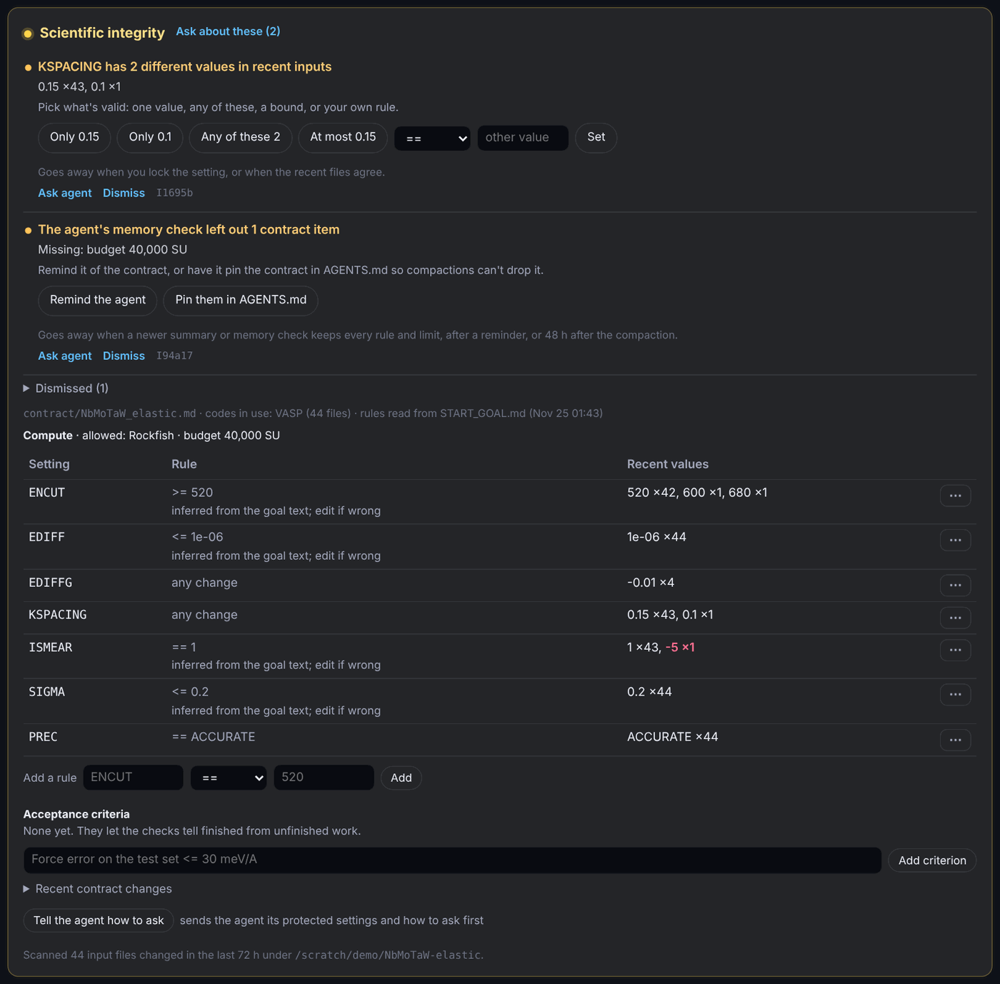
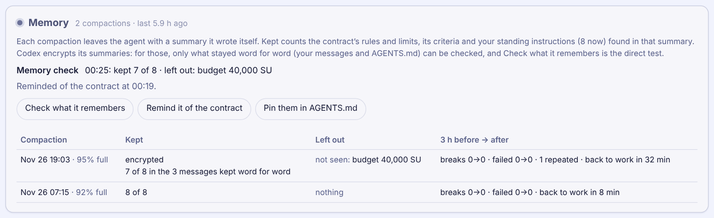
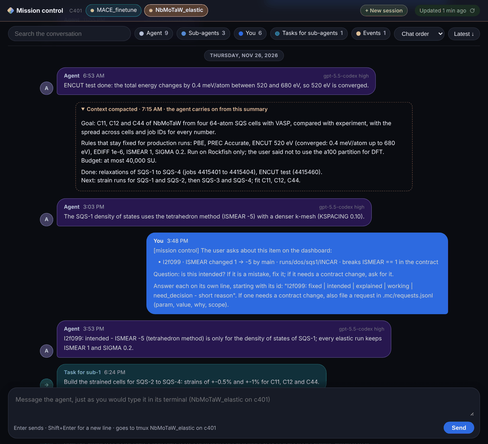
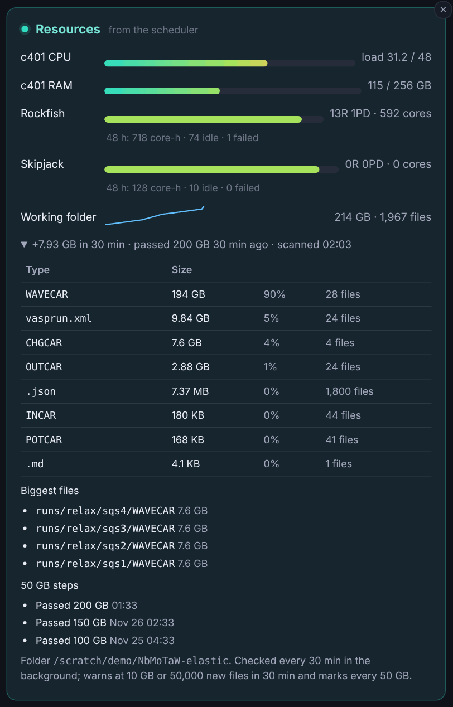
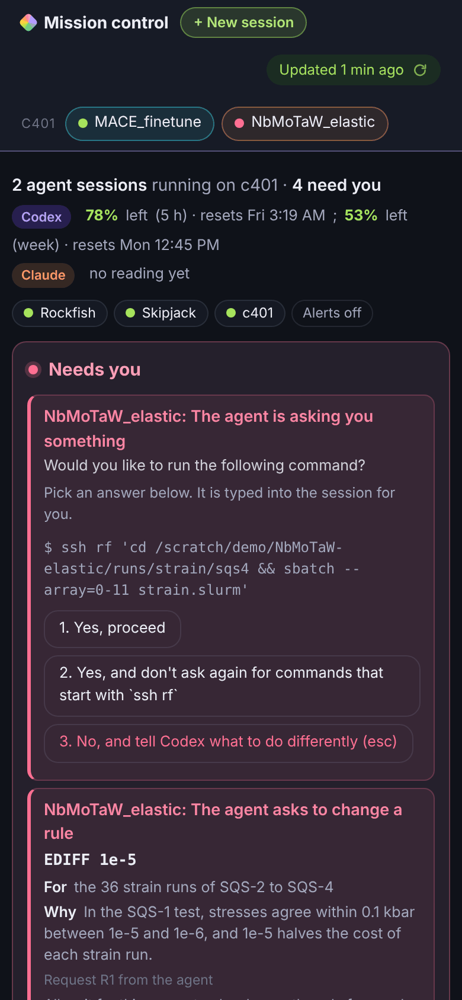
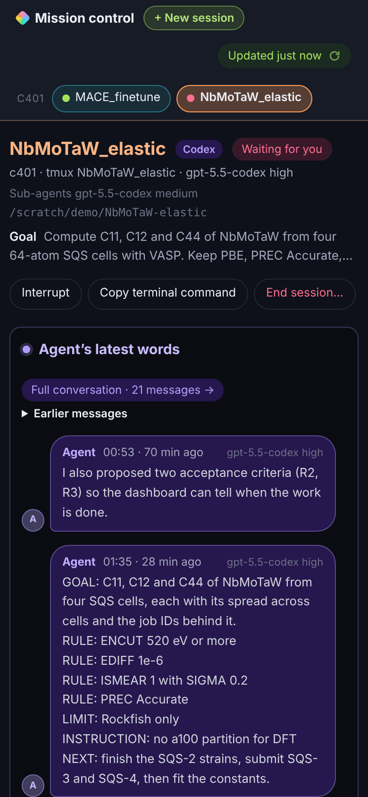

# Mission control

A dashboard and chat window for long-running Codex and Claude goal sessions on HPC clusters. It shows
what the agents are doing, whether they're sticking to the science, and whether compute is being
wasted, without you reading any reasoning traces. You can also message an agent from the page or
from your phone.

It was built for one researcher's setup and generalises from there:
- Windows PCs with WSL2 Ubuntu, sharing one folder through OneDrive (any synced folder works; a single
  machine works without one)
- Slurm clusters reached over SSH, where a script of yours opens long-lived shared connections
  (ControlMaster) to the login nodes and compute nodes. Rockfish and Skipjack are the reference
  clusters; others work through the same settings.
- agents running in tmux (or not) on compute nodes, login nodes or the PC itself

Mission control never logs in by itself. It only rides connections that already exist, so it can't
lock you out of a cluster with failed logins and never needs your credentials.

## What it looks like

The screenshots below come from a made-up demo: a Codex agent computing elastic constants with VASP
and a Claude Code agent fine-tuning a machine-learned potential, on one compute node. The pages follow
your system's dark or light setting; these are dark.

**The dashboard.** What needs you across all sessions comes first: here, a question on the agent's
screen you can answer with one tap, a rule change it asked for, an edit that broke the contract, and
acceptance criteria it proposed. Below are the sessions with their state and latest words.



**Needs you, on a session page.** Every item says what makes it go away by itself and has Ask agent and
Dismiss. The agent's answers show under the item ("intended" here), and its requests are laid out as the
change, what it is for and why, with Allow for this request, Change the rule or Reject.



**Scientific integrity.** Every watched setting in the agents' recent input files, checked against the
contract. A setting seen with several values can be locked to the ones you accept with one tap.



**Memory.** What each compaction kept of the contract and your instructions, how the agent worked before
and after, and buttons to check what it remembers, remind it, or pin the rules in AGENTS.md.



**The conversation.** Everything you and the agents said, sub-agents included, with each compaction's
summary folded in place and a box to message the agent as if you were at its terminal.



**The working folder** (under Resources): its size over two days, what kind of files fill it, the biggest
files, and every 50 GB crossed. **On the phone**, the same pages, laid out for a narrow screen.

<p>  </p>

## Start it (once per machine)

Put this folder somewhere every machine can see (for example inside OneDrive), then in WSL Ubuntu:

```bash
bash /path/to/mission-control/mctl setup
```

On a machine where the folder is somewhere in OneDrive, this finds it by itself:

```bash
bash "$(ls -d /mnt/*/Users/*/OneDrive*{,/*,/*/*,/*/*/*}/mission-control 2>/dev/null | head -1)/mctl" setup
```

The first run creates `config.env` from `config.example.env`. Fill in at least:
- `CONNECT_CMD`: the alias you run to open your shared SSH connections (used in "run ..." hints)
- `NEVER_CONTACT`: hosts mission control must never touch, if any (matched anywhere in an alias, host
  name or socket name)
- `PRIMARY_HOST`: the always-on PC that collects
- `SJ_TARGET` and `NODES` if you use a second cluster or fixed compute nodes

Setup finds your cluster SSH aliases, checks each connection, installs the `mctl` command, starts
the background collector and opens the dashboard in your browser.

From then on, on every machine, just type **`mctl`**. It starts the collector if needed and opens
the dashboard. `mctl help` lists the other commands.

Only one machine collects at a time: `PRIMARY_HOST`. The others stand by and show the same dashboard
through the shared folder. A standby machine takes over by itself if the primary stops for about half
an hour, but only if it has shared connections of its own. (It judges this by watching the primary's
heartbeat file change, so a laptop with a drifting clock or a slow OneDrive doesn't jump in.)

After that you don't need to do anything else:
- The collector refreshes every 5 minutes. It restarts by itself whenever you open a WSL shell.
- Open pages keep themselves current. Opened with `mctl` (or on your phone), a page updates in place
  within about 15 s of new data, keeping your scroll position, open blocks and any message you're typing.
  Opened straight from the shared folder, it reloads every 2 minutes. Click the "Updated ..." status to
  ask the collector for fresh data right away (at most once every 4 minutes).
- If a connection drops, the dashboard turns red and tells you to run your connection script. The next
  cycle picks the connection up again.
- `dashboard.html` sits in the shared folder, so it syncs to your other devices.

## Message an agent from the dashboard

Each session page has a box under "Agent's latest words". Type as you would in the agent's terminal
and press Enter (Shift+Enter for a new line). Mission control pastes it into that tmux pane and
presses Enter, then shows the agent's screen a few seconds later. It works for Codex and Claude.
- It works on the dashboard opened with `mctl` (http://localhost:8765). The same page opened straight
  from the shared folder is read-only.
- It goes through the machine's own shared connections, so a machine without them can't send.
- If the agent's screen shows an approval or y/n question, it holds the message (typing could answer
  the question), shows the question with its answers as buttons, and offers "Send anyway". Only the
  bottom of the screen counts and the agent's own words are skipped, so "approved" in something the
  agent wrote doesn't hold your message.
- From WSL: `mctl send --goal NAME "please continue"`. Every message sent is logged in
  ~/.local/state/mission-control/sent.log on that machine.
- Safety: the page server listens only on this machine and every send needs a secret key that only its
  own pages carry, so no website or other program can type into your sessions. `WEB_SERVER=0` in
  config.env turns it off.

## Start a new session from the dashboard

Click **+ New session** in the top bar (on the dashboard opened with `mctl`, or on your phone).
- Pick the agent (Codex or Claude), then the model and thinking level. The lists come from the agents
  installed on the node, so they stay current. For Codex you also pick the command that starts it: your
  own launchers such as `codex_chat` or `codex_api` each use their own account. The one your running
  sessions use is preselected.
- How much of each agent's usage is left shows at the top: Codex from its own session logs, Claude from
  what Claude Code reports to the status line of sessions started here (your own status line still shows).
- Give it a name: that is the tmux session name. The folder defaults to a new folder of that name next to
  your other sessions' folders (`LAUNCH_ROOT` in config.env changes that). Your first message can send the
  agent anywhere else.
- The first message is optional. Long ones are saved in the folder as `START_TASK.md` (or `START_GOAL.md`)
  and the agent is asked to read it. Tick "Make it a Codex goal" to start it with `/goal`.
- **Check** tests everything without starting anything. **Start session** opens a login shell in tmux on the
  node, starts the agent, waits until it is ready and types your first message. If the agent asks something
  first (trusting a new folder, signing in, an update), its screen shows in the dialog and you answer there.
- From WSL: `mctl launch --name NAME --agent codex --cmd codex_chat --model gpt-6.2-astra --effort high --check`

## Talking with the agent about what the page shows

Every item on a session page (Needs you, Scientific integrity, Watchdog) has a short id (like `I3fa21`),
a line saying what makes it go away by itself, and two buttons:
- **Ask agent** sends the agent that item (or, with "Ask the agent about all", every red and amber item
  in the section) with its id and your question (or "is this intended? fix it if not"). The agent answers
  one line per item, `I3fa21: fixed | intended | explained | working | need_decision - reason`, in its
  reply or in `.mc/answers.jsonl` in its folder, and the answer shows under the item. An item shows as
  asked only once the message went out; the dashboard collects again about 2 minutes later so the answer
  shows up sooner, and a sleeping or busy agent answers when it gets to it.
- **Dismiss** (or **Accept the answer**, once the agent has explained) hides an item you judge a non-issue:
  it stops counting and folds into "Dismissed (N)" at the end of its section until it changes, for 7 days
  at most. **Bring back** undoes it. Only the agent's requests can't be dismissed: approve or reject them.

Decisions on the contract go both ways too: the agent asks for a change in `.mc/requests.jsonl`
(setting, value, why, scope) and you choose **Allow for this request** (recorded as an amendment, the rule
stays), **Change the rule** (the rule itself is widened), or **Reject**; the agent is told either way, and
every change you make yourself (lock, unlock, allow, criteria, Make binding) is sent to it as well. The agent
can also propose acceptance criteria there (`"criterion": "..."`), which you add one by one or with
**Add all**.
Edits that only mention a setting in notes or docs (`.md`, `.txt`, ...) are not counted as changes, values
are compared the way VASP reads them (`0.10` = `0.1`, `T` = `.TRUE.`, `Acc` = `Accurate`), and an edit the
agent already asked you about shows as "waiting for your decision" instead of a second alarm.

## Memory across compactions and long runs

Long goal sessions compact their context: the agent carries on from a summary it wrote itself, and that is where
constraints tend to get lost. The Memory card on each session page checks every compaction:
- **Kept**: how many of the contract's rules and limits, its acceptance criteria and your standing instructions appear
  in that summary, and which ones it left out. Rules count only with their value ("ENCUT 520 eV" counts, "ENCUT" alone
  doesn't).
- **Before → after**: contract-breaking edits, failed commands and repeated commands in the hours before and after,
  and how long the agent took to get back to real work (an edit, a submission or a plan update).
- **Check what it remembers** asks the agent to list its goal, rules, limits, criteria, your instructions and next steps
  from memory (lines starting `GOAL:`, `RULE:`, ...) and scores the answer the same way. **Remind it of the contract**
  sends them again.

A summary or memory check that leaves out a rule or limit, or a jump in breaks or failures after a compaction, becomes
an item on the page, and so do hours of work with no plan step finished and the same command run over and over. The
summaries themselves show, folded, in the conversation. Compactions from before this was added are read once from the
session's log.

## Answer the agent's questions

When an agent asks something (Codex or Claude approval prompts, a numbered menu, a y/n question), the
session's "Needs you" card shows the question and one button per answer. Pressing one (and confirming)
types that answer into the session: the arrow keys to the option, then Enter. The screen is read again
first, so if the question changed in the meantime nothing is pressed. Questions that need a typed answer:
write it in the message box and use "Send anyway". From WSL: `mctl answer --goal NAME --choice 2 --sig SIG`
(the page fills in the question's signature).

## Session buttons

Each session page has **Interrupt** (presses Esc: the agent stops what it is doing and waits),
**Copy terminal command** (the ssh/tmux command that opens the session in your own terminal) and
**End session** (closes its tmux session after you type its name; the conversation stays in the agent's
logs, so `codex resume` or `claude --resume` can continue it).

## Desktop alerts

Turn on **Desktop alerts** at the top of the dashboard: while any mission control tab is open, a new red item
(an agent waiting for you, failing jobs, a lost connection) pops up as a notification.

## On your phone

Phone access goes through Tailscale, a private network of only your own devices; nothing is opened to
the internet. One-time setup:
1. Install Tailscale for Windows on the collecting PC (https://tailscale.com/download) and sign in.
2. Install the Tailscale app on your phone and sign in with the same account.
3. In WSL on that PC, run `mctl phone`. It shares the dashboard with your tailnet and prints the
   address to open on your phone (https://<pc-name>.<your-tailnet>.ts.net/). If Tailscale asks you to
   enable HTTPS for your tailnet, follow its link once.

The phone gets the same pages, including chat with the agents. Only your own Tailscale login is let
in; anything else from outside is refused. `tailscale serve reset` on that PC stops sharing.

## Every running agent, no configuration

Every Codex or Claude session that is running right now shows up on its own. You don't edit any files
when you start a new tmux session.
- Where it looks: every tmux session on the nodes in `NODES`, the Rockfish and Skipjack login nodes,
  this PC's WSL, and any node your connection script keeps a shared connection to on the Rockfish login
  node. Agents running outside tmux (screen, nohup, an IDE terminal) are found too and named
  "codex in <folder>".
- `dashboard.html` is the overview: one card per session, grouped by host, with what the agent is doing
  now (working, sleeping until a check, waiting for you, silent) and its latest words.
- The bar at the top of every page lists all sessions with a status dot; one click switches between them.
- Each session page opens with the agent's latest words. Every agent message shows the model and
  reasoning level that wrote it. Click the goal or the folder in the header to see them in full.
  "Full conversation" shows the whole history, colour-coded: you, the agent, sub-agents, events and
  Codex's approval reviewer (hidden by default). Search and filters sit at the top.
- Each goal has its own contract, `contract/<tmux session name>.md`. It keeps itself up to date (see
  "The contract keeps itself current" below).
- To watch only some sessions, set `GOALS="MY_GOAL OTHER"` instead of `auto`.
  `LOGIN_DIGESTS=0` and `AUTO_NODES=0` turn off the login-node and auto-node searches.
- If a node goes down, its goals stay on the overview as "node unreachable" until it's back.

## More machines: other servers, HPC nodes, your PCs

`HOSTS` in config.env adds machines to watch, the same way as the Rockfish nodes:
- `HOSTS="myserver"`: an ssh alias your connection script keeps a shared connection to on this PC.
- `HOSTS="node12@gateway"`: a machine reached from another host (here `gateway`) through the shared
  connection your script left there, the way the Rockfish nodes are reached from the login node.
- `/15` after a name checks it only every 15 minutes, e.g. `HOSTS="myserver/15 node12@gateway"`.
- These are optional: one that is offline (say its VPN is down) just doesn't show, with no alarms.
- `mctl hosts` lists what is watched and the live shared connections you could add;
  `mctl hosts add NAME` and `mctl hosts remove NAME` edit `HOSTS` for every machine.
- Your other PCs: a PC that stands by (not collecting) publishes its own WSL sessions to the shared folder
  (`state/pcs/`), so your laptops' sessions show up on the dashboard too, and you can message,
  answer, interrupt and start sessions on them. Those requests go straight to the other PC over Tailscale
  (under a second). When Tailscale can't get through (a VPN such as Proton or a university VPN in the way,
  Tailscale off, the PC asleep), they go through the shared folder instead (`state/inbox/` and
  `state/outbox/`, about a minute, as fast as OneDrive syncs). The reply says which way it went.
  The same route lets a laptop's dashboard act through the PC that has the connections.
  Each PC's collector shares its server with your own Tailscale devices by itself (the same as
  `mctl phone`); `RELAY_TAILSCALE=0` in config.env keeps everything on the shared folder.
  `PUBLISH_PC=0` in a machine's config turns publishing off.
- New session lists every watched host with its own accounts, models and starting folder.
- Hide anything you don't need: hover over a block and click its x (that browser only; the
  "Hidden here" bar at the top brings it back). `mctl hide` lists the block names, and
  `mctl hide screen watchdog` or `mctl hide "codex in my-folder"` hides them on every machine;
  `mctl unhide NAME` undoes it.

## The contract keeps itself current

Every collection, each goal's contract is brought up to date by itself, under one rule: **automatic
changes only add or tighten**. Anything that would loosen a rule waits under "Waiting for your OK" and in
the "Needs you" card, with Approve and Reject buttons.
- **The goal's own instructions**: `START_GOAL.md`, `START_TASK.md` or `GOAL.md` in the agent's folder,
  and the Codex goal text, are read every cycle. Settings (`ENCUT = 520`, `PREC = Accurate`), allowed and
  forbidden clusters ("Rockfish Slurm only", "no Skipjack"), budgets ("100,000 SU ceiling"), CPU caps
  ("node CPU at or below 50%") and result targets ("below 2 meV/atom") become contract lines tagged
  `# from START_GOAL.md`.
- **The run files**: the input files are scanned for VASP (INCAR, POTCAR pseudopotentials), DeePMD
  (training input.json) and LAMMPS settings. A value every recent input file agrees on (5 files or more,
  over two collections) is locked, tagged `# learned`. Settings that differ by structure are left alone.
- **The goal text** follows the Codex goal while it is the auto-filled copy; one you wrote yourself is
  kept, with a note when the Codex goal changes.
- **Compute** always lists the hosts mission control watches and the ones it never contacts.
- **Old copies** (contracts of sessions gone for 3 days) move to `contract/old/` and come back if the
  session returns.
- Breaks of an automatic rule show amber with "Keep the rule" and "Allow" buttons; breaks of your own
  rules show red. Jobs on a cluster the contract doesn't allow, budget use and CPU caps are checked too.

Changing it from the page, in the Scientific integrity card: Lock, Unlock or Keep each setting, add a
rule or an acceptance criterion, and press "Make binding" next to any instruction you sent (or right after
sending one). A rule you unlock or remove is never locked again automatically. Each change you make is
also sent to the agent as a short message ("ENCUT is no longer locked; you may choose its value..."), so
it plans with the new rule; `CONTRACT_TELL_AGENT=0` in config.env turns that off.

**The agent asks permission**: "Tell the agent how to ask" sends it the protected settings and the way to
ask: one JSON line in `.mc/requests.jsonl` in its folder, e.g.
`{"id": "R1", "param": "ENCUT", "value": "600", "why": "cutoff convergence check"}`. The request shows up
in "Needs you" with Approve and Reject; either way the agent gets a message with your answer.

You can still edit the file by hand any time (the OneDrive phone app works too); remove a line's `# ...`
tag to make it yours.

## Daily use

| Command | What it does |
|---|---|
| `mctl status` | One-screen text summary of all goals (`--goal NAME` for one) |
| `mctl goals` | List the goals mission control sees |
| `mctl open` | Open the dashboard |
| `mctl peek mlip` | Live tmux screen of a goal (read-only; any unique prefix of the session name works) |
| `mctl amend --goal mlip "force target applies to bcc too"` | Add a dated amendment to that goal's contract |
| `mctl promote U1a2b3c` | Make one of your TUI instructions binding (it knows which goal it came from) |
| `mctl referee [goal]` | Second-model review (all goals if none named) |
| `mctl doctor` | Re-check every connection |
| `mctl restart` | Restart the collector |

With a single goal running, you can leave out `--goal`.

## What it checks

- **Goal**: Is the agent alive in tmux? Is it waiting for your approval, quiet, or stalled?
  It also shows the agent's own plan, context compactions (a known cause of goal drift),
  quota and token budget.
- **Science**: Each goal's contract lists watched parameters, kept current from the goal's instructions
  and its run files (see above). Mission control then flags:
  - every agent edit that breaks a rule
  - every recent input file that breaks a rule
  - "shortcut" wording such as "to save time", "placeholder" or "loosened"

  An instruction you typed in the TUI that names the new value counts as permission.
- **Results**: Write targets in plain English under "Acceptance criteria" in the contract, for
  example `- DeePMD test energy RMSE below 20 meV/atom` or `- force RMSE under 100 meV/Å`. Targets
  stated in your goal are picked up automatically. Each target is checked against real `dp test`
  output, from the agent's own commands or from `*test*.log` files, with lcurve.out as a fallback.
  Mission control also flags:
  - an agent saying a target is met when the test output says it isn't
  - an agent reporting a better number than any test produced
  - testing on systems that are in the model's training data
  - tests on fewer than 50 frames

  For any other number, add `- custom: label | regex with one (number) group | <= value`.
  Targets that aren't numbers go to the referee.
- **Compute**: Running and pending jobs come from Slurm, not from what the agents say. It also flags:
  - share of idle or failed core-hours over 48 h
  - bursts of quick failures while they may still be happening (cleared once a later job runs fine),
    duplicate submissions (tasks of one array job don't count) and long-pending jobs (jobs on hold
    are shown as a note, jobs waiting on another job are left alone, and jobs whose dependency failed
    are flagged because they can never start). A job run from another session's folder shows on that
    session's page, not on every page.
  - low CPU efficiency
  - idle GPUs that are holding memory
  - which agent submitted each job

## Optional extras (edit `config.env`)

- **Phone pushes**: set `NTFY_TOPIC` to a long random name and subscribe to it in the free ntfy
  app. You'll get new red/amber alerts plus a morning brief. Topics on ntfy.sh are public by name,
  so pick something known only to you/team.
- **Referee**: set `REFEREE_CMD="claude -p"` (or `codex exec -`) and `REFEREE_EVERY_H=6`. A second
  model then reviews the contract, your instructions and the evidence every 6 h. Its verdict appears
  on the dashboard.
- **Agent decision notes**: paste `AGENT_INSTRUCTIONS.md` into the TUI once. The agents' reasons then
  show up in the timeline.

## Safety

Mission control reads session logs, the tmux screen (`capture-pane`), `squeue`/`sacct`/`sinfo`
and node load. It acts only when you press a button on its pages (or run the matching `mctl` command):
it types a message you send, presses Esc for Interrupt, starts a session you set up in the New session
dialog, or ends a session after you type its name. It never submits or cancels jobs, never logs in by
itself and never contacts a host listed in `NEVER_CONTACT`. Each cycle sends a few hundred KB.

## Developing

Work in a clone outside OneDrive (git and OneDrive syncing the same `.git` folder don't mix), then
deploy into the shared folder the machines run from:

```bash
git clone https://github.com/Hashan-Peiris/mission-control.git ~/src/mission-control
cd ~/src/mission-control
git config core.hooksPath tools/hooks   # once: blocks commits of collected data, settings or credentials
# ...edit...
tools/check.sh                          # syntax checks (also run by the hook and by deploy)
tools/deploy.sh                         # copies the code into the shared folder
git commit -am "what changed" && git push
```

`tools/deploy.sh` copies code and docs only: your settings, contracts and collected data in the
shared folder are never touched. Every machine picks up the new code within about 5 minutes.
See SECURITY.md for what must never be committed.
